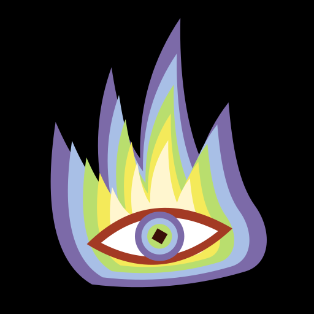
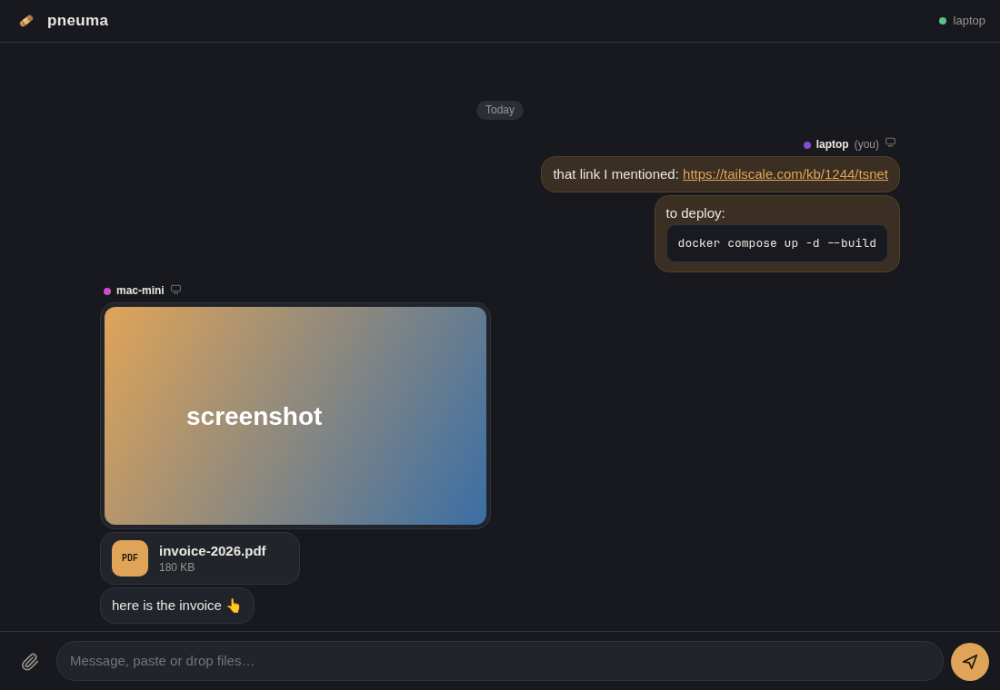
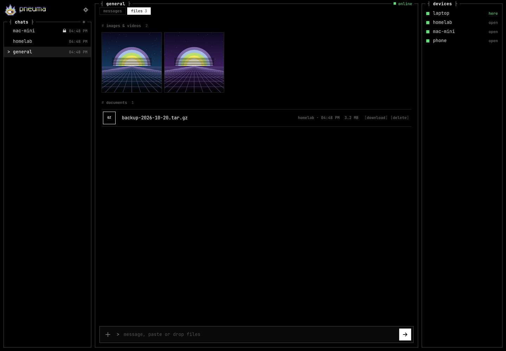
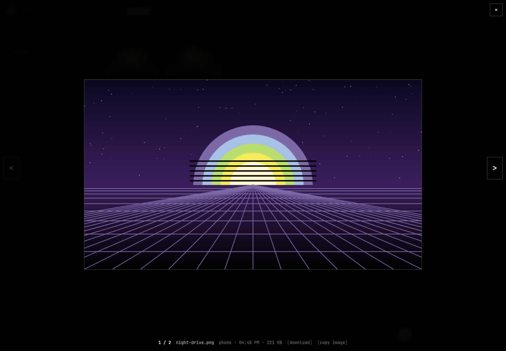
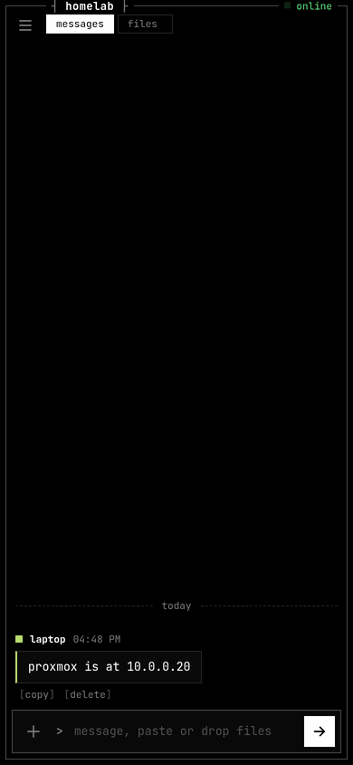
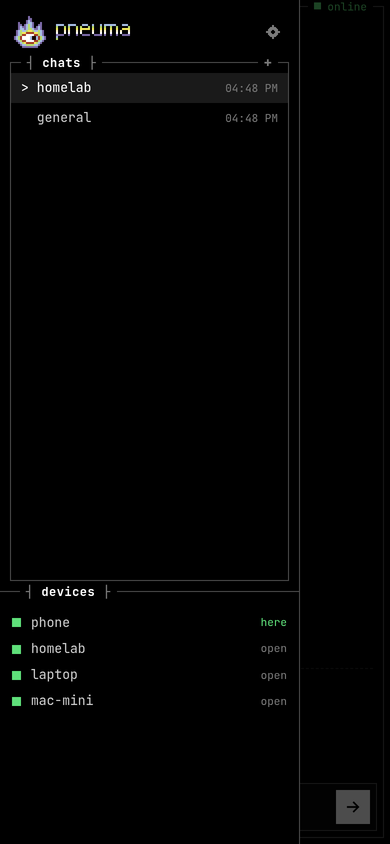

<p align="center">
  
</p>

<h1 align="center">pneuma</h1>

<p align="center">
  <b>Un chat privado y una bandeja de archivos entre tus propios equipos, a través de tu tailnet de <a href="https://tailscale.com">Tailscale</a>.</b><br>
  Escribe, pega o arrastra lo que sea en un equipo y aparecerá en todos los demás.
</p>

<p align="center">
  <a href="README.md">English</a> ·
  <a href="docs/ARCHITECTURE.md">Arquitectura (en inglés)</a> ·
  <a href="#ponerlo-en-marcha">Ponerlo en marcha</a>
</p>



## Por qué

Pasar un fragmento de código, un enlace, una captura o un archivo entre tus propios equipos sigue siendo un engorro. Taildrop envía archivos, pero no guarda historial ni tiene chat. LocalSend necesita la red local. Las apps de mensajería hacen pasar tus cosas por servidores de otros.

pneuma es un programa pequeño que vive en una máquina que ya tienes (un servidor casero, un NAS, una VM). Se une a tu tailnet como un nodo más y da a todos tus equipos un sitio compartido y privado donde soltar cosas.

## Qué hace

- **Pensado para copiar y pegar.** `Ctrl+V` envía una captura o archivos, puedes arrastrar y soltar en cualquier parte de la ventana, y un clic en cualquier mensaje lo copia. Los bloques de código (```` ``` ````) se copian por separado y las imágenes tienen *copiar imagen*.
- **Sin cuentas ni contraseñas.** pneuma pregunta a Tailscale qué equipo hay al otro lado de cada petición, así que cada mensaje va firmado con el equipo que lo envió.
- **Chats.** Crea, renombra y borra chats con clic derecho, o manteniendo pulsado en pantallas táctiles. Los chats que no estás mirando muestran un contador de no leídos.
- **Chats privados.** Pulsa un dispositivo y elige *empezar chat privado*: solo los equipos que están dentro pueden verlo, y eso lo hace cumplir el servidor, no se queda en ocultarlo en la interfaz. Desde el mismo menú puedes añadir más equipos.
- **Panel de dispositivos.** Lista todos los equipos de tu tailnet: verde relleno es pneuma abierto, borde verde es en línea y gris es desconectado. Puedes renombrar cualquiera ("pixel-8-pro" → "móvil") para todos.
- **Pestaña de archivos y galería.** Cada chat tiene una vista *archivos* con miniaturas de imágenes y vídeos y una lista de documentos, con descargar y borrar en cada uno. Al pulsar una foto se abre una galería que recorres con ← →, deslizando o con las flechas, y que cierras con la X o Esc.
- **Caducidad.** Por defecto nada caduca: archivos y mensajes se conservan **para siempre**. El borrado automático de archivos (en el historial queda una línea "📎 nombre — caducado") se activa en los ajustes, donde también se regula la conservación de mensajes.
- **Ajustes.**
  - De cada equipo: idioma (español, inglés o automático), tamaño de texto, si Enter envía, notificaciones de escritorio y animaciones.
  - Para todos: caducidad de mensajes y archivos, tamaño máximo de subida y espacio usado.
- **Instalable como app (PWA)** en Android, macOS, Windows y Linux. En Android, pneuma aparece en el menú **Compartir** del sistema.
- **En tiempo real** mediante Server-Sent Events, y se resincroniza solo tras una reconexión.
- **Un único binario estático y pequeño.** Go sin CGO, SQLite y archivos normales en disco, y una interfaz sin paso de compilación. Las fuentes van incluidas, así que no se carga nada de internet.

<p align="center">
  
  
</p>
<p align="center">
  
  
</p>

## Cómo funciona

```
 portátil ─┐                          ┌──────────────────────────────────┐
 mac ──────┼── WireGuard (tailnet) ──▶│ pneuma            (nodo tsnet)   │
 móvil ────┘   + HTTPS (Let's Encrypt)│                                  │
                                      │  WhoIs(ip) → equipo, usuario, ID │
                                      │  SQLite + archivos en disco      │
                                      │  SSE → actualizaciones en vivo   │
                                      └──────────────────────────────────┘
```

1. pneuma lleva Tailscale dentro mediante [`tsnet`](https://tailscale.com/kb/1244/tsnet). La primera vez inicia sesión como cualquier otro equipo y pasa a ser `pneuma.<tu-tailnet>.ts.net`, con su propio certificado TLS. No necesita Tailscale instalado en la máquina, ni interfaz VPN, ni puertos abiertos.
2. En cada petición HTTP pregunta al Tailscale integrado *¿quién es?* (`WhoIs`). La respuesta incluye el nombre del equipo, su dueño y su **ID estable de nodo**, así que no hay nada en lo que iniciar sesión.
3. Los mensajes son filas de SQLite. Las subidas se escriben directamente en disco, sin pasar por la memoria, y se calcula su hash por el camino.
4. Cada ventana abierta mantiene un flujo de Server-Sent Events. Los mensajes nuevos, los borrados, los cambios de nombre y los cambios de presencia se envían solo a los equipos que pueden verlos.

Los detalles (modelo de datos, API HTTP, eventos, caducidad) están en [docs/ARCHITECTURE.md](docs/ARCHITECTURE.md).

## Ponerlo en marcha

Necesitas:

- una cuenta de [Tailscale](https://tailscale.com) (el plan gratuito sirve);
- **MagicDNS y certificados HTTPS** activados en la consola de administración, en [DNS](https://login.tailscale.com/admin/dns). pneuma los usa para obtener su nombre `*.ts.net` y su certificado;
- una máquina que esté siempre encendida para ejecutarlo.

### Docker Compose (recomendado)

```sh
git clone https://github.com/ericpastorm/pneuma
cd pneuma
docker compose up -d --build
docker logs -f pneuma        # la primera vez: abre la URL de login que aparece
```

Para no tener que abrir la URL de login, crea una [auth key](https://login.tailscale.com/admin/settings/keys) y arráncalo así:

```sh
TS_AUTHKEY=tskey-auth-… docker compose up -d --build
```

Después, en la [consola de Tailscale](https://login.tailscale.com/admin/machines), abre la máquina `pneuma` y elige **Disable key expiry**. Si no, saldrá del tailnet a los 180 días.

Abre `https://pneuma.<tu-tailnet>.ts.net` desde cualquiera de tus equipos. La primera petición HTTPS puede tardar unos segundos mientras se emite el certificado.

Todo el estado (base de datos, archivos e identidad de Tailscale del nodo) vive en el volumen `pneuma-data`. Si haces copia de seguridad de ese volumen, la tienes de pneuma.

Para actualizar:

```sh
git pull && docker compose up -d --build
```

### Binario

```sh
go install github.com/ericpastorm/pneuma/cmd/pneuma@latest
pneuma                      # los datos van a ~/.config/pneuma
```

Ejecútalo con systemd o similar para que siga funcionando. Solo escucha dentro del tailnet.

## Configuración

Todo tiene un valor por defecto razonable. Lo marcado con ⚙ también se cambia desde la app, y lo que guardes ahí tiene prioridad.

| Variable | Flag | Por defecto | |
|---|---|---|---|
| `PNEUMA_HOSTNAME` | `-hostname` | `pneuma` | Nombre del nodo en el tailnet |
| `PNEUMA_DATA_DIR` | `-data` | `~/.config/pneuma` (`/data` en Docker) | Base de datos, archivos y estado del tailnet |
| `PNEUMA_MAX_UPLOAD` ⚙ | `-max-upload` | `4GB` | Tamaño máximo por subida |
| `PNEUMA_ALLOWED_USERS` | `-allowed-users` | todo el tailnet | Logins de Tailscale permitidos, separados por comas |
| `PNEUMA_ALLOW_TAGGED` | `-allow-tagged` | `false` | Permitir nodos con tag (servidores, CI) |
| `TS_AUTHKEY` | | | Auth key de Tailscale para instalaciones desatendidas |

Ajustes compartidos por todos los equipos, desde la app:

| Ajuste | Por defecto |
|---|---|
| Borrar archivos tras | nunca (configurable) |
| Borrar mensajes tras | nunca |
| Subida máxima | `PNEUMA_MAX_UPLOAD` |

## Modelo de seguridad

- **En tránsito: cifrado por partida doble.** El tráfico viaja dentro de los túneles WireGuard de Tailscale, de extremo a extremo entre tu equipo y el nodo pneuma, y además va por HTTPS con un certificado emitido para el nombre de pneuma.
- **En reposo: sin cifrar.** Los mensajes y archivos se guardan tal cual en la máquina donde corre pneuma. Cualquiera con root en esa máquina puede leerlos. Si te importa, cifra el disco de esa máquina.
- **Solo accesible desde tu tailnet.** No escucha en internet ni en tu red local, y no hay puertos que abrir.
- **La identidad la da Tailscale.** Cada petición se identifica con `WhoIs`. Los nodos con tag se rechazan por defecto, porque son infraestructura y no de una persona. Puedes restringir más con `PNEUMA_ALLOWED_USERS` y con las ACL de tu tailnet.
- **Los chats privados los hace cumplir el servidor.** Los miembros se guardan por **ID estable de nodo**, no por nombre, así que una máquina nueva que herede el nombre de otra antigua no hereda sus chats. Un equipo que no es miembro recibe `404` para todo lo relacionado con ese chat, archivos incluidos, y nunca recibe sus eventos en vivo. Solo se pueden añadir equipos que existan ahora mismo en tu tailnet.
- **Los archivos subidos no pueden ejecutar código.** Se sirven con `Content-Security-Policy: sandbox` y `X-Content-Type-Options: nosniff`. Lo que podría ejecutarse (HTML, SVG…) siempre se descarga, nunca se muestra.
- **Se rechazan las peticiones de otros sitios.** Una web maliciosa abierta en uno de tus navegadores no puede escribir ni borrar en nombre de ese equipo: pneuma usa `http.CrossOriginProtection` de Go.
- **Lo que pneuma no es.** Cualquier equipo permitido puede leer y borrar todo lo que hay en los chats que ve. pneuma está pensado para los equipos de una persona, o de una casa, no para chatear con desconocidos.

## Instalarlo como app

- **Android (Chrome):** abre la URL y pulsa *Instalar app*. pneuma aparecerá en el menú Compartir de cualquier app.
- **macOS:** Safari → *Archivo → Añadir al Dock*, o *Instalar* en Chrome.
- **Windows / Linux (Chrome, Edge):** *Instalar pneuma* desde la barra de direcciones.
- **Linux con Omarchy / Hyprland:** asígnale una tecla en `~/.config/hypr/bindings.lua`:

  ```lua
  o.bind("SUPER + SHIFT + P", "pneuma", { webapp = "https://pneuma.<tu-tailnet>.ts.net/", focus = true })
  ```

## Desarrollo

```sh
go run ./cmd/pneuma -dev     # http://localhost:8080, sin Tailscale
```

El modo dev sirve en localhost con una identidad falsa. Añade `?as=<nombre>` a la URL para hacerte pasar por otro equipo: dos pestañas, `?as=portatil` y `?as=movil`, ya son una conversación. La interfaz es HTML, CSS y JavaScript sin más en [`web/`](web), incluida en el binario y sin paso de compilación: editas, recompilas y recargas.

```sh
go vet ./... && go test -race ./...
```

```
cmd/pneuma/        punto de entrada: flags, tsnet o -dev, bucle de caducidad
internal/ident/    quién llama: WhoIs de Tailscale, lista de equipos, identidad dev
internal/store/    SQLite: chats, mensajes, archivos, ajustes, alias
internal/hub/      reparto de Server-Sent Events con audiencia por equipo
internal/server/   API HTTP, control de acceso, subidas/descargas, ajustes
web/               la app web (HTML/CSS/JS, iconos, fuentes, service worker)
```

Se agradecen issues y pull requests. Por favor, que sean pequeños y sin dependencias nuevas.

## Créditos

- [JetBrains Mono](https://www.jetbrains.com/lp/mono/) se usa bajo la [SIL Open Font License](web/fonts/OFL-JetBrainsMono.txt).
- El logo y el logotipo son pixel art original hecho para pneuma.

## Licencia

[MIT](LICENSE)
