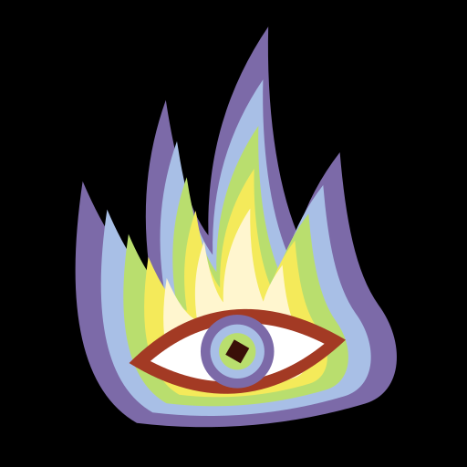
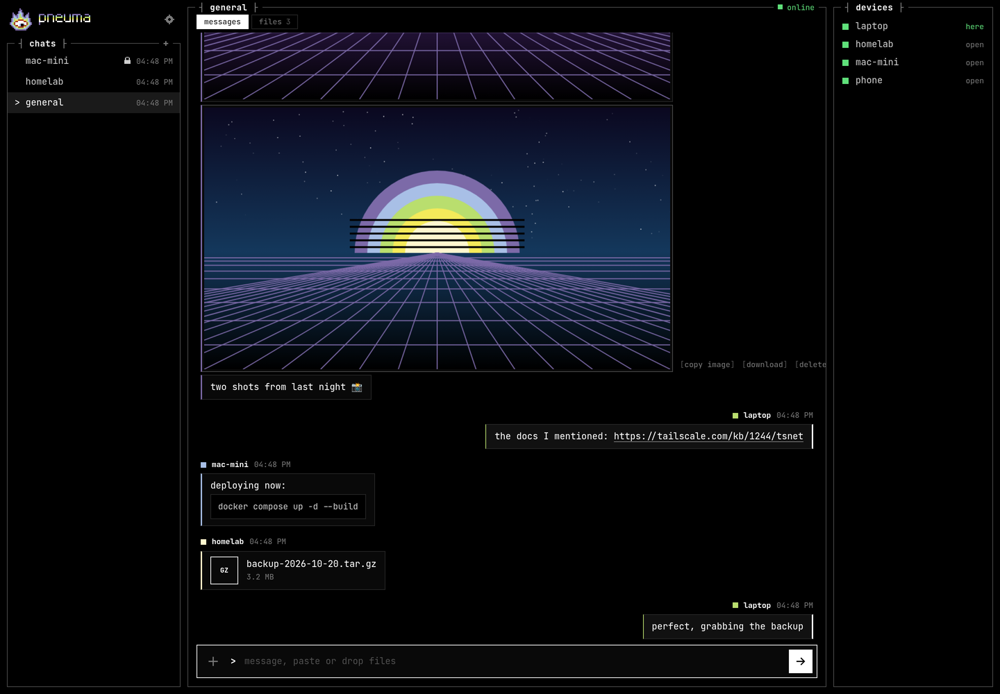
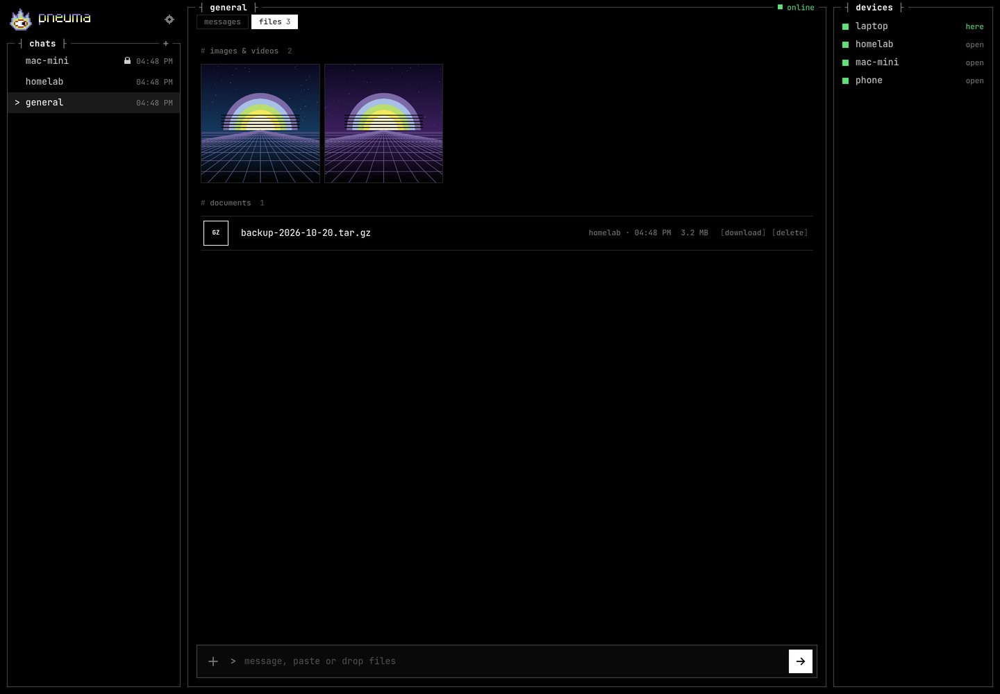
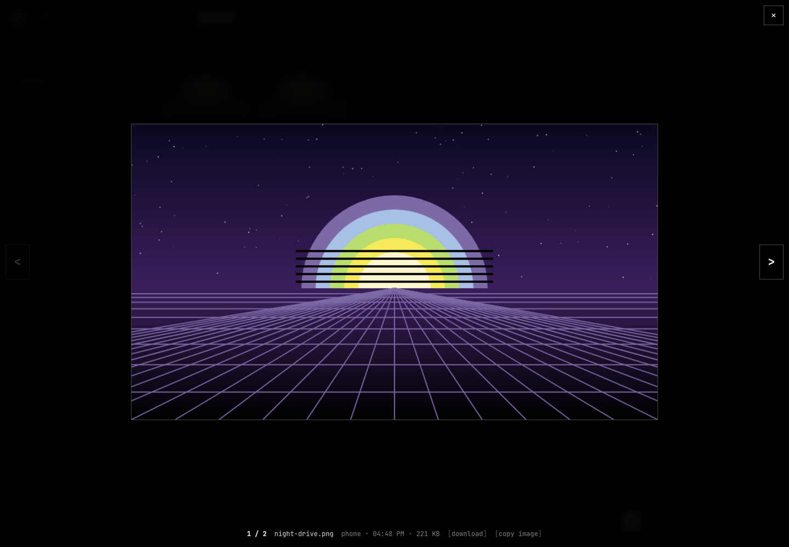
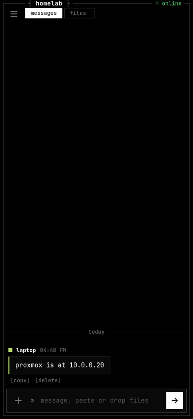
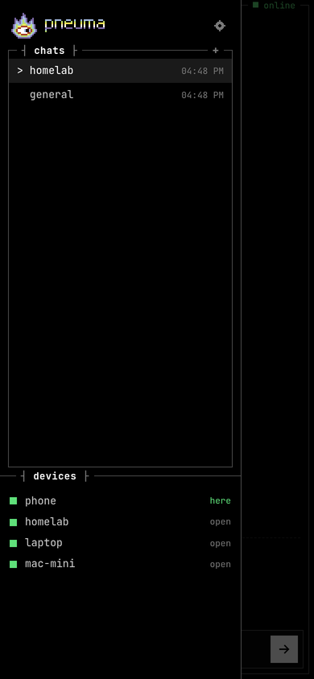

<p align="center">
  
</p>

<h1 align="center">pneuma</h1>

<p align="center">
  <b>A private chat and file drop for your own devices, over your <a href="https://tailscale.com">Tailscale</a> tailnet.</b><br>
  Type, paste or drop anything on one machine and it shows up on all the others.
</p>

<p align="center">
  <a href="README.es.md">Español</a> ·
  <a href="docs/ARCHITECTURE.md">Architecture</a> ·
  <a href="#run-it">Run it</a>
</p>



## Why

Moving a snippet, a link, a screenshot or a file between your own machines is still oddly annoying. Taildrop sends files but has no history and no chat. LocalSend needs the LAN. Messaging apps route your stuff through someone else's servers.

pneuma is one small program that lives on a machine you already have (a home server, a NAS, a small VM). It joins your tailnet as its own node and gives every device you own a shared, private place to paste things into.

## Features

- **Copy & paste first.** `Ctrl+V` a screenshot or files to send them, drag and drop anywhere in the window, or click any message to copy it. Code blocks (```` ``` ````) get their own copy target, and images get *copy image*.
- **No accounts, no passwords.** pneuma asks Tailscale which device is on the other end of every request. Each message is signed with the device that sent it.
- **Chats.** Create, rename and delete chats with a right click, or a long press on touch screens. Unread counts appear on the chats you're not looking at.
- **Private chats.** Click a device and choose *start private chat*: only the devices in it can see it, and that is enforced by the server, not just hidden in the UI. Add more devices later from the same menu.
- **Devices panel.** Lists every device on your tailnet: green filled means pneuma is open, a green outline means online, grey means offline. Rename any of them ("pixel-8-pro" → "phone") for everyone.
- **Files tab and gallery.** Every chat has a *files* view with a thumbnail grid for images and videos and a list for documents, each with download and delete. Clicking a picture opens a gallery you can browse with ← →, by swiping, or with the arrows, and close with the X or Esc.
- **Retention.** By default files expire after **30 days** and messages are kept forever, since text costs nothing. Expired files leave a "📎 name — expired" line in the history. Both limits can be changed in the settings.
- **Settings.** Per device: language (English / Spanish / auto), text size, whether Enter sends, desktop notifications and animations. For all devices: message and file retention, maximum upload size and storage used.
- **Installable (PWA)** on Android, macOS, Windows and Linux. On Android, pneuma shows up in the system **Share** menu.
- **Live updates** over Server-Sent Events, with automatic resync after a reconnect.
- **One small static binary.** Go, no CGO, SQLite and plain files on disk, and a frontend with no build step. The fonts are embedded, so nothing is loaded from the internet.

<p align="center">
  
  
</p>
<p align="center">
  
  
</p>

## How it works

```
 laptop ─┐                          ┌───────────────────────────────┐
 mac ────┼── WireGuard (tailnet) ──▶│ pneuma          (tsnet node)  │
 phone ──┘   + HTTPS (Let's Encrypt)│                               │
                                    │  WhoIs(ip) → device, user, ID │
                                    │  SQLite + files on disk       │
                                    │  SSE → live updates           │
                                    └───────────────────────────────┘
```

1. pneuma embeds Tailscale through [`tsnet`](https://tailscale.com/kb/1244/tsnet). On first start it logs in like any other device and becomes `pneuma.<your-tailnet>.ts.net`, with its own TLS certificate. It does not need Tailscale installed on the host, a VPN interface or open ports.
2. For every HTTP request it asks the local Tailscale daemon *who is this?* (`WhoIs`). The answer is the device's name, owner and **stable node ID**, so there is nothing to log in to.
3. Messages are rows in SQLite. Uploads are streamed straight to disk, never held in memory, and hashed on the way.
4. Every open window keeps a Server-Sent Events stream. A new message, deletion, rename or presence change is pushed only to the devices allowed to see it.

The details (data model, HTTP API, events, retention) are in [docs/ARCHITECTURE.md](docs/ARCHITECTURE.md).

## Run it

You need:

- a [Tailscale](https://tailscale.com) account (the free plan is fine);
- **MagicDNS and HTTPS certificates** enabled in the admin console under [DNS](https://login.tailscale.com/admin/dns). pneuma uses them to get its `*.ts.net` name and certificate;
- a machine that stays on to run it.

### Docker Compose (recommended)

```sh
git clone https://github.com/ericpastorm/pneuma
cd pneuma
docker compose up -d --build
docker logs -f pneuma        # first run: open the login URL it prints
```

To skip the login URL, create an [auth key](https://login.tailscale.com/admin/settings/keys) and start it with:

```sh
TS_AUTHKEY=tskey-auth-… docker compose up -d --build
```

Then, in the [Tailscale admin console](https://login.tailscale.com/admin/machines), open the `pneuma` machine and choose **Disable key expiry**, or it will drop off the tailnet after 180 days.

Open `https://pneuma.<your-tailnet>.ts.net` from any of your devices. The very first HTTPS request can take a few seconds while the certificate is issued.

All state (database, files and the node's Tailscale identity) lives in the `pneuma-data` volume. Back that up and you have backed up pneuma.

To update:

```sh
git pull && docker compose up -d --build
```

### Binary

```sh
go install github.com/ericpastorm/pneuma/cmd/pneuma@latest
pneuma                      # data goes to ~/.config/pneuma
```

Run it under systemd or similar so it stays up. It only listens on the tailnet.

## Configuration

Everything has a sensible default. Settings marked ⚙ can also be changed from the web app; the values saved there win over these.

| Env var | Flag | Default | |
|---|---|---|---|
| `PNEUMA_HOSTNAME` | `-hostname` | `pneuma` | Node name on the tailnet |
| `PNEUMA_DATA_DIR` | `-data` | `~/.config/pneuma` (`/data` in Docker) | Database, files and tailnet state |
| `PNEUMA_MAX_UPLOAD` ⚙ | `-max-upload` | `4GB` | Max size per upload |
| `PNEUMA_ALLOWED_USERS` | `-allowed-users` | everyone in the tailnet | Comma-separated Tailscale logins allowed in |
| `PNEUMA_ALLOW_TAGGED` | `-allow-tagged` | `false` | Let tagged nodes (servers, CI) in |
| `TS_AUTHKEY` | | | Tailscale auth key for unattended setup |

The web app also has these settings, shared by all devices:

| Setting | Default |
|---|---|
| Delete files after | 30 days |
| Delete messages after | never |
| Max upload | `PNEUMA_MAX_UPLOAD` |

## Security model

- **In transit: encrypted twice.** Traffic travels inside Tailscale's WireGuard tunnels, end to end between your device and the pneuma node, and on top of that over HTTPS with a certificate issued for pneuma's own name.
- **At rest: not encrypted.** Messages and files are stored in plain form on the machine running pneuma. Anyone with root on that machine can read them. Use disk encryption on the host if that matters to you.
- **Reachable only from your tailnet.** Nothing listens on the internet or your LAN, and there are no ports to publish.
- **Identity comes from Tailscale.** Every request is identified with `WhoIs`. Tagged nodes are rejected by default, because they belong to infrastructure rather than to a person. Narrow access further with `PNEUMA_ALLOWED_USERS` and your tailnet ACLs.
- **Private chats are enforced by the server.** Members are stored by **stable node ID**, not by name, so a new machine that later takes an old device's name does not inherit its chats. A device outside a chat gets `404` for everything about it, including its files, and never receives its live events. You can only add devices that currently exist on your tailnet.
- **Uploads can't run code.** Files are served with `Content-Security-Policy: sandbox` and `X-Content-Type-Options: nosniff`. Anything that could execute (HTML, SVG…) is always downloaded, never rendered.
- **Cross-site requests are rejected.** A malicious page open in one of your browsers can't post or delete on that device's behalf: pneuma uses Go's `http.CrossOriginProtection`.
- **What pneuma is not.** Every allowed device can read and delete everything in the chats it can see. pneuma is built for one person's devices, or a household, not for chatting with strangers.

## Install it like an app

- **Android (Chrome):** open the URL and tap *Install app*. pneuma then appears in the Share menu of every app.
- **macOS:** Safari → *File → Add to Dock*, or *Install* in Chrome.
- **Windows / Linux (Chrome, Edge):** *Install pneuma* from the address bar.
- **Linux with Omarchy / Hyprland:** bind it to a key in `~/.config/hypr/bindings.lua`:

  ```lua
  o.bind("SUPER + SHIFT + P", "pneuma", { webapp = "https://pneuma.<your-tailnet>.ts.net/", focus = true })
  ```

## Development

```sh
go run ./cmd/pneuma -dev     # http://localhost:8080, no Tailscale needed
```

Dev mode serves on localhost with a fake identity. Add `?as=<name>` to the URL to pretend to be another device: two tabs, `?as=laptop` and `?as=phone`, make a conversation. The frontend is plain HTML, CSS and JavaScript in [`web/`](web), embedded into the binary, with no build step: edit, rebuild, reload.

```sh
go vet ./... && go test -race ./...
```

```
cmd/pneuma/        entry point: flags, tsnet or -dev, retention loop
internal/ident/    who is calling: Tailscale WhoIs, device list, dev identity
internal/store/    SQLite store: chats, messages, files, settings, aliases
internal/hub/      Server-Sent Events fan-out with per-device audiences
internal/server/   HTTP API, access checks, uploads/downloads, settings
web/               the web app (HTML/CSS/JS, icons, fonts, service worker)
```

Issues and pull requests are welcome. Please keep it small and dependency-free.

## Credits

- [JetBrains Mono](https://www.jetbrains.com/lp/mono/) is used under the [SIL Open Font License](web/fonts/OFL-JetBrainsMono.txt).
- The logo and wordmark are original pixel art made for pneuma.

## License

[MIT](LICENSE)
